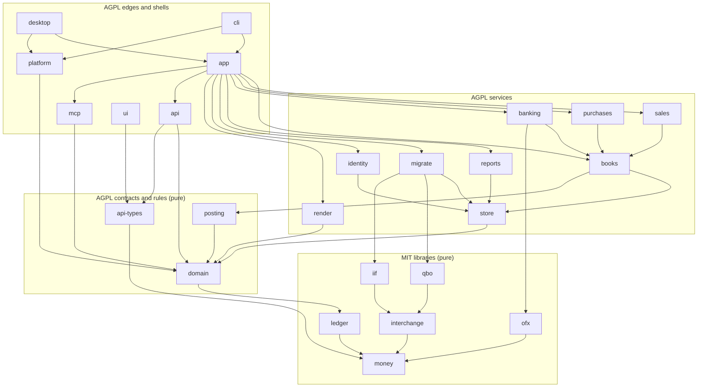
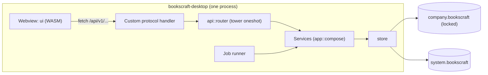
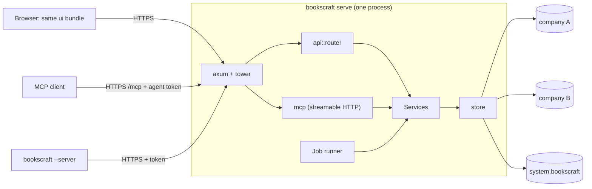
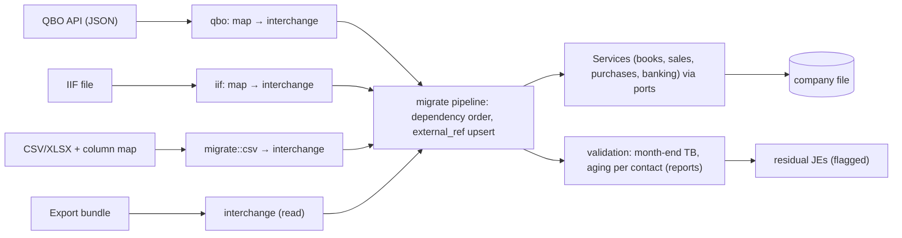

# Architecture

Status: accepted (2026-10-10), except the UI framework, which stays provisional until spike W0-06 passes ([ADR-0002](../adr/0002-ui-framework.md)). Owner: `lead-architect`.

BooksCraft is one Rust core with four shells: desktop app, server (HTTP API plus web UI), CLI and MCP server. Company data lives in one SQLite file per company. Contracts (types and traits) are fixed in Wave 0, so parallel builders can work against them without touching each other's code.

Related: [LEDGER_SPEC.md](LEDGER_SPEC.md), [DATA_MODEL.md](DATA_MODEL.md), [API.md](API.md), [MIGRATION_SPEC.md](MIGRATION_SPEC.md), ADRs in [`docs/adr/`](../adr/).

## 1. Principles

| # | Principle | Consequence |
|---|---|---|
| 1 | One core, many shells | Desktop, server, CLI and MCP all call the same services through the same `domain::ports` traits. No feature exists in only one shell. |
| 2 | Pure center, I/O at the edges | `money`, `ledger`, `posting`, `domain`, `interchange`, `iif`, `ofx`, `qbo` and `api-types` have no I/O. Everything that touches disk, network, clock or OS lives in `store`, the services, the shells and `platform`. |
| 3 | Contract-first | `domain` (types, ports, error codes, capabilities) and `api-types` (wire DTOs) are complete for MVP after Wave 0. Changes go through a CCR processed in a Weave. |
| 4 | Local-first, your file | A company is one file the user can copy, back up and open elsewhere. The server is the same binary that manages many files. |
| 5 | The UI is an HTTP client in every mode | The same WASM bundle runs in the desktop webview and in browsers. It only knows `/api/v1`. |
| 6 | 100% Rust | All code and build automation are Rust (`cargo xtask`). Data and config files (SQL, TOML, YAML, Markdown, CSS, the HTML host page, Typst templates, Flatpak manifest) are not code ([ADR-0030](../adr/0030-rust-boundary.md)). |
| 7 | Clean room | Compatibility comes only from Intuit's public API documentation and published file formats. UI copy is our own (section 11). |

## 2. Crate map

28 workspace members, plus the UI spike in its own workspace. Package names are `bookscraft-<dir>`; the CLI binary is `bookscraft`, the desktop binary `bookscraft-desktop`. "Pure" means no filesystem, network, database, clock, environment or async runtime.

| Path | License | Pure | Responsibility | Direct workspace deps | First WP |
|---|---|---|---|---|---|
| `crates/money` | MIT | yes | `Minor`, `Money`, `Currency`, decimal `Rate`, rounding modes, `allocate`, checked arithmetic, decimal-string serde | — | W0-02 |
| `crates/ledger` | MIT | yes | `BalancedEntry`, posting lines, reversal, trial balance fold, lock evaluation, invariant checks | money | W0-05 |
| `crates/interchange` | MIT | yes | Open import/export model (the documented export bundle; MIGRATION_SPEC §3) | money | W1-04 |
| `crates/iif` | MIT | yes | IIF reader and writer; IIF ↔ interchange mapping | interchange, money | W1-04 |
| `crates/ofx` | MIT | yes | OFX 1.x (SGML) and 2.x (XML), QFX and QBO (Web Connect) statement parser | money | W1-04 |
| `crates/qbo` | MIT | yes | QBO API entity types (serde) and mapping to interchange | interchange, money | W3-03 |
| `crates/domain` | AGPL | yes | Contracts: ids, dates, entities, documents, commands, queries, errors, capabilities, principals, permission matrix, ports | money, ledger | W0-02 |
| `crates/posting` | AGPL | yes | Document → postings rules, versioned per document type | domain, ledger, money | W0-05, W1-01 |
| `crates/api-types` | AGPL | yes | HTTP request/response DTOs; compiles to `wasm32-unknown-unknown`; OpenAPI derives behind feature `openapi` | money | W0-02 |
| `crates/store` | AGPL | no | SQLite files, migrations, write path, triggers' error codes, audit chain, file lock, backup, verify, idempotency and job storage | domain, ledger, money | W0-04 |
| `crates/books` | AGPL | no | Company lifecycle and settings, chart of accounts and templates, contacts, items, terms, payment methods, tax setup and tax computation, dimensions, custom fields, attachments, journal entries, opening balances, period locks, drafts and approvals, generic document queries | domain, store, posting, ledger, money | W1-02 |
| `crates/sales` | AGPL | no | Estimates, invoices, sales receipts, customer payments, credit memos, refund receipts, customer refunds | domain, store, posting, books, money | W2-01 |
| `crates/purchases` | AGPL | no | Bills, bill payments, vendor credits, expenses, card credits, vendor refunds | domain, store, posting, books, money | W2-02 |
| `crates/banking` | AGPL | no | Deposits, transfers, statement import, review queue, rules, reconciliation, bank feed providers | domain, store, posting, books, ofx, money | W2-03, W4-05 |
| `crates/reports` | AGPL | no | Report engine over `ledger_line`; accrual and cash basis; CSV output | domain, store, ledger, money | W2-04 |
| `crates/migrate` | AGPL | no | Import pipeline (interchange → services), QBO connector, CSV and IIF sources, parity validation, rollback, export bundle | domain, store, interchange, qbo, iif, money | W3-04, W4-03 |
| `crates/identity` | AGPL | no | Users, memberships, sessions, API and agent tokens, authentication, server secret store (envelope encryption) | domain, store | W1-03 |
| `crates/render` | AGPL | no | Typst invoice, statement and report templates → PDF and SVG preview; email via SMTP | domain, money | W4-04 |
| `crates/api` | AGPL | no | axum router, middleware (auth, idempotency, ETag, errors, limits), OpenAPI document, route modules per area | domain, api-types, money | W1-05 |
| `crates/mcp` | AGPL | no | MCP server (rmcp): read and draft tools with scopes | domain | W5-02 |
| `crates/app` | AGPL | no | Composition root: builds every service from a `store::Stores` plus `domain::ports::Infra`; job runner | domain, store, books, sales, purchases, banking, reports, migrate, identity, render, api, mcp | W1-05 |
| `crates/ui` | AGPL | n/a | Leptos client-side app compiled to WASM: shell, design system, pages | api-types, money | W2-05 |
| `crates/platform` | AGPL | no | All OS-specific code: directories, keychain, open URI, webview environment fixes, file permissions | domain | W0-01 (dirs), W3-05 |
| `crates/desktop` | AGPL | no | Tauri 2 shell: window, custom protocol, embedded router, desktop principal | app, api, platform | W3-05 |
| `crates/cli` | AGPL | no | `bookscraft` binary: `serve`, `mcp`, `company`, `import`, `export`, `verify`, `backup`, `user`, `token`, `report` | app, api, mcp, platform | W4-02 |
| `crates/test-support` | AGPL | n/a | Builders, fixtures, golden helpers, proptest strategies, audit assertions (dev-only) | domain, store, ledger, posting, money | W0-03 |
| `tests/scenarios` | AGPL | n/a | Scenario spine (package `bookscraft-scenarios`) | test-support, app, domain | W0-03 |
| `xtask` | AGPL | n/a | Build automation (`cargo xtask`); no workspace deps | — | W0-01 |
| `spikes/ui` | AGPL | n/a | UI spike, its own Cargo workspace, excluded from the root workspace (not a member) | — | W0-06 |



Arrows are direct dependencies; transitive ones are omitted. Test-only crates are omitted.

## 3. Dependency rules (enforced by `cargo xtask lint` from W0-01)

| # | Rule | Why |
|---|---|---|
| D-1 | An MIT crate depends only on MIT workspace crates and on external crates whose license expression is satisfied by the permissive list in `deny-mit.toml` | Library crates stay usable under MIT (I-12, ADR-0005) |
| D-2 | A pure crate depends on none of `tokio`, `rusqlite`, `reqwest`, `hyper`, `axum`, `tauri`, `lettre`, `keyring`, `std::fs`, `std::net`, `std::process` | I-2, testability |
| D-3 | `ui` depends only on `api-types`, `money` and UI or WASM crates | The UI is an HTTP client (principle 5) |
| D-4 | `cfg(target_os = ...)`, `cfg(windows)`, `cfg(unix)`, `cfg(target_family = ...)` and target-specific dependencies appear only in `crates/platform` | I-13 |
| D-5 | `std::process::Command` appears only in `xtask` | I-13: no shelling out |
| D-6 | `f32`/`f64` do not appear in `money`, `ledger` or `posting` (clippy `disallowed-types` plus token scan) | I-1 |
| D-7 | No service crate depends on another service crate except `books`, which `sales`, `purchases` and `banking` may use | Keeps the wave plan acyclic |
| D-8 | `api` and `mcp` call services only through `domain::ports` traits | Route and tool code can be written against contracts and fakes |
| D-9 | Every `.rs` file starts with the SPDX header of its crate's license | I-12 |
| D-10 | No authored `.js`, `.ts`, `.jsx`, `.tsx` or `package.json` anywhere in the repo | D-1 owner decision |

## 4. Contracts (Wave 0)

### 4.1 `domain` modules

| Module | Contents |
|---|---|
| `ids` | One newtype per entity id over `uuid::Uuid` (v7): `CompanyId`, `AccountId`, `ContactId`, `ItemId`, `TermId`, `PaymentMethodId`, `TaxAgencyId`, `TaxRateId`, `TaxCodeId`, `DimensionId`, `DimensionValueId`, `CustomFieldId`, `AttachmentId`, `DocumentId`, `LineKey`, `JournalEntryId`, `PostingId`, `SettlementId`, `BankFeedId`, `BankImportId`, `BankTxnId`, `BankRuleId`, `ReconciliationId`, `ImportRunId`, `UserId`, `TokenId`, `JobId`, `AuditEventId`, `RequestId` |
| `time` | `Date` (civil), `Timestamp` (UTC), `DateRange` |
| `entities` | `Company`, `CompanySettings`, `Account` (`AccountClass`, `AccountSubtype`, `SystemRole`), `Contact` (`ContactRoles`, `Address`), `Item` (`ItemKind`), `Term`, `PaymentMethod`, `TaxAgency`, `TaxRate`, `TaxCode`, `Dimension`, `DimensionValue`, `CustomFieldDef`, `Attachment` |
| `documents` | `DocumentType` (17 variants, DATA_MODEL §4.1), `DocumentStatus`, `Document` (header + `Vec<DocumentLine>` + `Vec<TaxLine>` + `Vec<Application>` + dimensions), `DocumentLine` (`LineKind`), `Application` (settlement request), `EstimateStatus`, `TaxMode`, `Discount` |
| `ledger_view` | `JournalView`, `PostingView`, `SettlementView`, `ClearingState` (read models returned by queries) |
| `commands` | One struct per write: `CreateAccount`, `UpdateAccount`, `SaveInvoice`, `PostDocument`, `VoidDocument`, `ApproveDocument`, `SetPeriodLocks`, `StartReconciliation`, ... (one per API write operation, API.md §5) |
| `queries` | Filters and pages: `Page { limit, cursor }`, `Paged<T>`, `DocumentFilter`, `ReportParams { basis, as_of, from, to, dimension filters, compare }` |
| `reports` | Typed results: `TrialBalance`, `ProfitAndLoss`, `BalanceSheet`, `GeneralLedger`, `Journal`, `Aging`, `SalesTaxLiability`, `AuditLogPage` |
| `errors` | `DomainError { code: ErrorCode, message, fields: Vec<FieldError>, status_hint }`, `ErrorCode(&'static str)` newtype; namespaces listed in API.md §4 |
| `auth` | `ActorType` (user, api, agent), `Via` (ui, api, mcp, cli, import, job), `Role`, `Scope`, `Principal`, `Permission`, `fn permits(principal, permission) -> bool` (the matrix in API.md §6) |
| `context` | `Ctx { company: CompanyId, principal: Principal, via: Via, request_id: RequestId, now: Timestamp, today: Date }` |
| `capability` | `Capability` enum (section 4.4) and `CapabilitySet` |
| `ports` | Service traits (section 4.2) and infrastructure traits (section 8) |

### 4.2 Service ports

All methods are synchronous (`fn`); handlers call them inside `tokio::task::spawn_blocking`. Every write method takes `&Ctx` and a command and returns the saved entity (or view) with its new `version`. Every read method takes `&Ctx` and filters. Errors are `DomainError`. Method names mirror API operations one to one (API.md §5).

| Trait | Implemented by | Covers |
|---|---|---|
| `CompanyService` | books | create (from template), list, get, update settings, period locks, backup, verify |
| `BooksService` | books | accounts, contacts, items, terms, payment methods, tax agencies, rates and codes, dimensions and values, custom fields, attachments, journal entries, opening balances, generic document get, search, history, journal, delete-draft, approve |
| `SalesService` | sales | estimates (incl. convert), invoices, sales receipts, customer payments, credit memos, refund receipts, customer refunds, open items per customer |
| `PurchasesService` | purchases | bills, bill payments, vendor credits, expenses, card credits, vendor refunds, open items per vendor |
| `BankingService` | banking | deposits, transfers, statement import, bank transactions (list, suggestions, match, add, exclude, undo), rules, reconciliations, bank feeds |
| `ReportsService` | reports | trial balance, P&L, balance sheet, general ledger, journal, AR and AP aging, sales tax liability, audit log; CSV rendering |
| `ImportService` | migrate | start import (qbo_api, csv, interchange, iif), status, validation report, rollback, QBO connect and token |
| `ExportService` | migrate | export bundle (interchange, csv) |
| `RenderService` | render | document PDF, SVG preview pages, send email (enqueues a job) |
| `IdentityService` | identity | users, memberships, login and logout, sessions, tokens |
| `Authenticator` | identity | resolve a cookie or bearer token to a `Principal`; desktop principal |
| `IdempotencyStore` | store | begin, complete and replay idempotent requests |
| `JobQueue` | store | enqueue, claim, complete and fail jobs |

`domain::ports::Services` is a struct of `Arc<dyn Trait>` for all of the above, built by `app::compose`.

### 4.3 `api-types`

| Module | Contents |
|---|---|
| `common` | `MoneyDto` (re-export of `money::Money` serde), `Page`, `Paged<T>`, `ProblemDetails`, `FieldError`, `Version` |
| one module per area | Request and response DTOs for every endpoint in API.md §5 (`accounts`, `contacts`, `items`, `tax`, `dimensions`, `custom_fields`, `attachments`, `documents`, `sales`, `purchases`, `banking`, `reports`, `imports`, `exports`, `identity`, `companies`, `jobs`, `settings`) |

Feature `openapi` adds `utoipa::ToSchema` derives; `ui` does not enable it. DTOs are deliberately separate from `domain` types so the wire format stays stable and the UI stays WASM-light.

### 4.4 Capabilities (feature registration)

Each service crate declares `pub const CAPABILITIES: &[Capability]` in its `lib.rs` and adds a capability only when it is fully implemented and tested. `app::compose` collects them. The scenario spine and `/api/v1/health` report them. Stubs start with an empty list.

| Crate | Capabilities |
|---|---|
| books | `Company`, `Accounts`, `Contacts`, `Items`, `Terms`, `PaymentMethods`, `Tax`, `Dimensions`, `CustomFields`, `Attachments`, `JournalEntries`, `OpeningBalances`, `PeriodLocks`, `Approvals`, `Verify` |
| identity | `Identity` |
| sales | `Estimates`, `Invoices`, `SalesReceipts`, `CustomerPayments`, `CreditMemos`, `RefundReceipts`, `CustomerRefunds`, `SalesTax` |
| purchases | `Bills`, `BillPayments`, `VendorCredits`, `Expenses`, `CardCredits`, `VendorRefunds` |
| banking | `Deposits`, `Transfers`, `BankImport`, `BankReview`, `BankRules`, `Reconciliation`, `BankFeeds` |
| reports | `Reports` |
| migrate | `ImportQbo`, `ImportCsv`, `ImportInterchange`, `ImportIif`, `Export` |
| render | `RenderPdf`, `Email` |

### 4.5 Fixed constructors (no composition hotspot)

Every service crate exposes exactly one constructor with a signature fixed in W0-01:

```rust
pub fn build(stores: bookscraft_store::Stores, infra: bookscraft_domain::ports::Infra) -> std::sync::Arc<dyn bookscraft_domain::ports::XxxService>;
pub const CAPABILITIES: &[bookscraft_domain::capability::Capability];
```

The W0-01 stub returns an implementation whose methods return `DomainError` code `api.not_implemented` (HTTP 501). `app::compose` calls every `build` from W1-05 on and never needs editing when a crate is implemented.

## 5. Process topology

| Component | Desktop solo | Server (`bookscraft serve`) | CLI local (`--company <file>`) | CLI remote (`--server <url>`) | MCP local (`bookscraft mcp --company <file>`) | MCP remote |
|---|---|---|---|---|---|---|
| UI (WASM) | In the Tauri webview, loaded from `bookscraft://localhost/` | In the browser, loaded from `https://host/` | — | — | — | — |
| API router | In-process, reached through the Tauri custom protocol; no TCP port | In-process, over HTTP(S) | — | Remote, over HTTPS with a bearer token | — | — |
| Services and store | In-process | In-process | In-process | Remote | In-process | Remote (server's) |
| Company file lock | Held by the desktop app | Held by the server for each open company | Held by the CLI for the run | — | Held by the MCP process | — |
| Authentication | Desktop principal (the OS profile user); optional app password | Sessions (cookie) and bearer tokens | Desktop principal of the system file | Bearer token | Agent token from the system file, or the desktop principal with agent actor type | Agent token (bearer) on `/mcp` |
| Jobs | In-process runner | In-process runner | Runs its own job inline | Server's | — | Server's |
| Transport | Custom protocol (Linux/macOS `bookscraft://localhost/`, Windows `http://bookscraft.localhost/`) | HTTP/1.1 and HTTP/2, TLS via rustls (`axum-server`) or a reverse proxy | — | HTTPS | stdio (JSON-RPC) | Streamable HTTP |

A company file has one owner at a time. If the desktop app has a file open, `bookscraft --company <same file>` fails with `store.company_locked`. MVP does not share a file between processes. v1 adds "connect to a server" in the desktop app (the same UI pointed at a remote URL) and a local socket for CLI and MCP while the desktop app runs.





Desktop custom protocol details (validated by the spike):

- The handler registered with `register_asynchronous_uri_scheme_protocol("bookscraft", ...)` converts the webview request into an `http::Request`, calls the router with `tower::ServiceExt::oneshot`, and returns the buffered response.
- Static UI assets are served by the same router, so relative URLs resolve to the same origin on every OS.
- Responses are buffered, so the API has no server-sent events or WebSockets in MVP; long operations are jobs that the UI polls.

## 6. Flows

### 6.1 Request flow (HTTP)

```mermaid
sequenceDiagram
  participant UI as ui (WASM)
  participant MW as api middleware
  participant H as handler
  participant SV as service (spawn_blocking)
  participant ST as store
  UI->>MW: POST /api/v1/companies/{cid}/invoices (Idempotency-Key, JSON)
  MW->>MW: request id, limits, tracing
  MW->>MW: Authenticator → Principal; permits(principal, permission)
  MW->>ST: IdempotencyStore.begin(principal, key, sha256(body))
  alt replay
    ST-->>UI: stored status + body
  end
  MW->>H: DTO
  H->>H: DTO → domain command (field validation)
  H->>SV: SalesService.save_invoice(ctx, cmd)
  SV->>ST: BEGIN IMMEDIATE; load; validate; write; audit; COMMIT
  ST-->>SV: saved document (version)
  SV-->>H: Invoice
  H-->>MW: 201 + ETag W/"1" + Location
  MW->>ST: IdempotencyStore.complete(...)
  MW-->>UI: 201 JSON
```

### 6.2 Posting flow

```mermaid
sequenceDiagram
  participant SV as service (e.g. sales)
  participant P as posting (pure)
  participant L as ledger (pure)
  participant ST as store
  SV->>ST: begin write transaction; load document revision + context
  SV->>SV: business validation (settlement bounds, deposit rule, reconciled lines, actor ≠ agent)
  SV->>P: post(document, revision, context)
  P->>L: BalancedEntry::new(lines)
  L-->>P: BalancedEntry or LedgerError
  P-->>SV: Option<BalancedEntry> (rules_version)
  SV->>ST: ledger::post_revision(document, entry, settlements, overrides)
  ST->>ST: lines n+1 → reversal(E_n) finalize → E_n+1 finalize → settlements → header → clearing → audit
  ST->>ST: no open entries; COMMIT
  ST-->>SV: JournalView, new version
```

### 6.3 Import flow



## 7. Feature registration and hotspots

| Hotspot | Mechanism | Rule |
|---|---|---|
| Service wiring | Fixed `build` constructors (section 4.5) called by `app::compose` | Nobody edits `app` after W1-05 except a Weave |
| Capabilities | `CAPABILITIES` const in each service crate | A crate adds only its own capabilities |
| HTTP routes | `crates/api/src/routes/<area>.rs` each exposing `pub fn router() -> Router<ApiState>` and `pub fn openapi() -> utoipa::openapi::OpenApi`; `routes/mod.rs` merges all areas (written once in W1-05 with empty placeholders) | A WP owns its area file only |
| UI routes and pages | `crates/ui/src/routes.rs` lists every MVP route (written once in W2-05); each `crates/ui/src/pages/<area>/` exports fixed component names | A WP owns its page directories only |
| Error codes | Constants in the owning crate; the string namespace matches the crate (store owns the trigger codes in schema.sql) | `cargo xtask lint` fails on duplicate code strings; `cargo xtask docs` regenerates the API.md code table in the Weave |
| Migrations | `crates/store/migrations/NNNN_<slug>.sql` | Only a Weave adds one (CCR) |
| Workspace manifest and lockfile | Root `Cargo.toml`, `Cargo.lock`, every `crates/*/Cargo.toml` | Only W0-01 and Weaves edit them; CI builds with `--locked` |
| xtask subcommands | Pre-registered in W0-01 (`doctor`, `lint`, `scope`, `ci`, `spine`, `hook`, `warm`, `ui`, `package`, `docs`, `dco`) | Later WPs fill a pre-registered module only if their prompt says so |

Full rules: [OWNERSHIP.md](../coordination/OWNERSHIP.md) and [PARALLEL_DEV_PLAYBOOK.md](../process/PARALLEL_DEV_PLAYBOOK.md).

## 8. Extension points

```rust
/// Tax rates for a sale (manual provider in MVP; automated providers later).
pub trait TaxRateProvider: Send + Sync {
    fn id(&self) -> &'static str;
    fn rates_for(&self, ctx: &Ctx, ship_to: Option<&Address>, date: Date) -> Result<Vec<TaxRateQuote>, DomainError>;
}

/// Bank data source. One trait for file import, SimpleFIN, Teller and Plaid; no schema change per provider.
pub trait BankProvider: Send + Sync {
    fn id(&self) -> BankProviderKind;                       // File, SimpleFin, Teller, Plaid
    fn connect(&self, ctx: &Ctx, setup: ProviderSetup) -> Result<Vec<ProviderAccount>, DomainError>;
    fn fetch(&self, ctx: &Ctx, feed: &BankFeedRef, since: Option<Date>) -> Result<FetchBatch, DomainError>;
}

/// Locale-specific behaviour: formats, chart-of-accounts templates, tax defaults.
pub trait LocalePack: Send + Sync {
    fn locale(&self) -> &'static str;                       // "en-US" in MVP
    fn coa_templates(&self) -> &'static [CoaTemplate];      // freelancer, agency, service business
    fn format_money(&self, value: Money) -> String;
    fn format_date(&self, date: Date) -> String;
    fn tax_defaults(&self) -> TaxDefaults;
}

/// Secrets by reference. Desktop: OS keychain (platform). Server: envelope encryption (identity).
pub trait SecretStore: Send + Sync {
    fn put(&self, purpose: SecretPurpose, company: Option<CompanyId>, secret: &[u8]) -> Result<CredentialRef, DomainError>;
    fn get(&self, credential: &CredentialRef) -> Result<Zeroizing<Vec<u8>>, DomainError>;
    fn delete(&self, credential: &CredentialRef) -> Result<(), DomainError>;
}

pub trait Mailer: Send + Sync { fn send(&self, message: OutgoingEmail) -> Result<(), DomainError>; }
pub trait Clock: Send + Sync { fn now(&self) -> Timestamp; }
pub trait IdGen: Send + Sync { fn new_id(&self) -> uuid::Uuid; }    // UUIDv7

pub struct Infra {
    pub clock: Arc<dyn Clock>,
    pub ids: Arc<dyn IdGen>,
    pub secrets: Arc<dyn SecretStore>,
    pub mailer: Arc<dyn Mailer>,
    pub tax_rates: Arc<dyn TaxRateProvider>,
    pub bank_providers: Vec<Arc<dyn BankProvider>>,
    pub locales: Vec<Arc<dyn LocalePack>>,
}
```

| Extension | MVP implementation | Later |
|---|---|---|
| Tax-rate provider | `books::tax::ManualRates` (rates from the company's tax codes) | Address-based providers (state rate tables, commercial APIs) as optional crates |
| Bank provider | `banking::feeds::FileProvider` (statement import); `banking::feeds::SimpleFin` (late MVP, W4-05) | Teller and Plaid (server mode, v1), Enable Banking (EU) |
| Locale pack | `books::locale::EnUs` with the freelancer, agency and US service business templates | UK/EU VAT, Canada GST/HST (community) |
| Secret store | `platform::secrets::Keychain` (desktop), `identity::secrets::Envelope` (server) | — |
| Mailer | `render::mail::Smtp` (lettre) | Provider APIs |

## 9. Platform layer

`crates/platform` is the only crate with OS-specific code (I-13).

| Function | Linux | Windows | macOS |
|---|---|---|---|
| `dirs::{data,config,cache,log}_dir()` | XDG base directories (`directories`) | Known folders (`directories`) | `~/Library/...` (`directories`) |
| `secrets::Keychain` | Secret Service over D-Bus (`keyring`) | Credential Manager (`keyring`) | Keychain (`keyring`) |
| `open::open_uri(url)` | XDG Desktop Portal OpenURI over D-Bus (`ashpd`) | `ShellExecuteW` (`windows`) | `NSWorkspace.openURL` (`objc2-app-kit`) |
| `webview::apply_env_fixups()` | Sets `WEBKIT_DISABLE_DMABUF_RENDERER=1` when NVIDIA (`/proc/driver/nvidia/version`) and Wayland (`WAYLAND_DISPLAY`) are both present, unless the user overrides it; the exact fix is confirmed by the spike | no-op | no-op |
| `fs::restrict_permissions(path)` | `chmod 0600` on company and system files | inherit ACLs | `chmod 0600` |
| `fs::is_probably_network_path(path)` | checks `/proc/self/mountinfo` filesystem type | UNC or mapped network drive | `statfs` type |

Rules:

- No `std::process::Command` (D-5). Opening a URL or file uses portals or OS APIs, never `xdg-open`.
- File pickers come from `tauri-plugin-dialog`, which uses portals on Linux, in the desktop crate.
- Printing uses the webview's print dialog.
- Paths are `PathBuf` end to end. Tests never assume `/` or a case-sensitive filesystem (T-PLAT-5).

## 10. UI architecture

| Topic | Decision |
|---|---|
| Framework | Leptos 0.8, client-side rendering, compiled to `wasm32-unknown-unknown` (provisional; ADR-0002) |
| Build | `cargo xtask ui build` compiles the crate, runs `wasm-bindgen` through the `wasm-bindgen-cli-support` library (versions pinned equal), and copies `index.html`, CSS and fonts into `target/ui-dist/`. No Trunk, no Node, no downloads at build time. |
| Serving | Both shells serve `ui-dist` through the same router: the desktop embeds it at compile time, the server reads it from the binary or a directory |
| API client | `crates/ui/src/api/` over `gloo-net`, relative URLs `/api/v1/...`, typed with `api-types`; it sends `Idempotency-Key` on creates and `If-Match` on updates, and turns problem details into field errors |
| State | Leptos signals and resources; no global client-side cache beyond the current page; optimistic concurrency conflicts show a reload prompt |
| Design system | `crates/ui/src/components/`: `DataTable` (virtualized rows, keyboard cell navigation, sortable columns), `MoneyInput`, `DateInput`, `ComboBox` (type-ahead), `LineItemsGrid`, `Dialog`, `Toast`, `FormField` (label, description, error), `PrintPreview` (SVG pages) |
| Keyboard-first | Global shortcuts (section 10.1); every action reachable without a mouse; focus visible; tab order follows reading order |
| Accessibility | Semantic HTML, labelled inputs, ARIA roles for grids and dialogs, live region for toasts, 4.5:1 contrast; verified with Orca (GNOME) in the spike and in UI acceptance tests |
| Print and PDF | Previews are SVG pages rendered by `render` (Typst); Print uses the webview print dialog on a print stylesheet; Save as PDF downloads the Typst PDF |
| Routes | Pre-registered in W2-05 (section 10.2) |

### 10.1 Keyboard shortcuts

| Keys | Action |
|---|---|
| `Ctrl+K` | Command palette: go to any page, create any document, search by number or contact |
| `Alt+N` | New record of the current list's type |
| `Ctrl+S` | Save |
| `Ctrl+Enter` | Save and post (when the user may post) |
| `Esc` | Close dialog, or cancel the current edit after confirmation if dirty |
| `/` | Focus the list filter |
| Arrow keys, `Home`/`End`, `PageUp`/`PageDown` | Move within tables and line grids |
| `Ctrl+D` | Duplicate the current line in a line grid |
| `Ctrl+P` | Print or preview the current document |

### 10.2 Routes and page ownership

| Route prefix (under `/c/:company`) | Page directory | WP |
|---|---|---|
| `/` (home), `/approvals` | `pages/home` | W2-05 |
| `/contacts`, `/items`, `/accounts`, `/journal-entries`, `/opening-balances` | `pages/books` | W2-05 |
| `/settings/{company,users,tokens,taxes,terms,payment-methods,dimensions,custom-fields,email}` | `pages/settings` | W2-05 |
| `/sales/{invoices,estimates,receipts,payments,credit-memos,refund-receipts,customer-refunds}` | `pages/sales` | W3-01 |
| `/purchases/{bills,bill-payments,expenses,vendor-credits,card-credits,vendor-refunds}` | `pages/purchases` | W3-02 |
| `/banking/{review,rules,reconcile,deposits,transfers,imports,feeds}` | `pages/banking` | W3-02 |
| `/reports/{trial-balance,profit-and-loss,balance-sheet,general-ledger,journal,ar-aging,ap-aging,sales-tax}` | `pages/reports` | W4-01 |
| `/close`, `/audit`, `/migrate` | `pages/close`, `pages/audit`, `pages/migrate` | W4-01 |
| Print and email actions on sales documents | `pages/sales/print.rs` | W5-03 |
| `/login`, `/companies` (outside a company) | `pages/session` | W2-05 |

## 11. Terminology (own UI copy, clean room)

BooksCraft writes its own labels and help text. "QuickBooks" appears only in factual interoperability statements, such as the migrator's "Import from QuickBooks Online".

| Concept | BooksCraft label |
|---|---|
| Customer payment applied to invoices | Payment received |
| Payments waiting to be deposited | Undeposited funds |
| Bank lines awaiting a decision | To review |
| Statement reconciliation | Reconcile |
| Lock dates | Close the books (soft lock / hard lock) |
| Sales tax liability by agency | Sales tax owed |
| AI-created documents awaiting approval | Approvals |
| Expense paid by card or check | Expense |
| Generic dimensions | Tags (Class, Location and Project are built-in tag groups) |

## 12. Background jobs, email and rendering

- **Jobs** (ADR-0024). The `job` table is in the system file. `app` runs one runner thread per process that claims due jobs (`queued`, `run_after <= now`), runs them as the creating principal, and retries with backoff (1 min, 5 min, 30 min, then failed). Kinds: `email_send`, `import`, `export`, `bank_sync`, `backup`, `verify`, `reversing_entry`. The CLI runs a job inline.
- **Email.** `render::mail::Smtp` uses lettre over TLS. SMTP settings live in the system file (server) or the desktop profile; the password goes through `SecretStore`. Invoices are sent as PDF attachments.
- **Rendering.** Typst is used as a library with embedded fonts (no system font scan in tests). Templates are data files in `crates/render/templates/`. Output is a PDF document or SVG pages for preview. The renderer is deterministic: golden PDFs are compared by extracted text and page count, SVG by snapshot.

## 13. Security model

| Area | Rule |
|---|---|
| Desktop | Single OS user. Optional app password (argon2id) gates the UI at start. Company and system files are created `0600` where the OS supports it. No network listener. |
| Server authentication | Local accounts (argon2id; login rate-limited per username and per IP in memory). Sessions in an HttpOnly, Secure, `SameSite=Strict` cookie; mutating browser requests also need header `X-BooksCraft-Client: ui`. API and agent tokens are `Authorization: Bearer bc_<32 random bytes, base32>` and stored as SHA-256. OIDC arrives in v1. |
| Authorization | Role × permission matrix in `domain::auth` (API.md §6); token scopes narrow it further; `agent` principals can never post, void, approve, delete, change locks, manage users or read secrets (I-10). |
| Secrets | `SecretStore` only: OS keychain on desktop, envelope encryption on the server (AES-256-GCM data keys wrapped by a key-encryption key from the server config file or environment; `kek_version` allows rotation). Secrets never reach logs, audit events or exports. |
| Input limits | JSON bodies up to 2 MB; uploads up to 25 MB per attachment; statement files up to 10 MB; CSV imports up to 200,000 rows; every list endpoint is paginated (max 500). |
| Transport | Server: TLS via rustls or a reverse proxy; HSTS when TLS is on. Desktop: in-process. |
| Supply chain | `cargo deny` (licenses, advisories, bans, sources) in CI; `Cargo.lock` committed; `--locked` everywhere. |

## 14. Observability

`tracing` with `tracing-subscriber`. Desktop writes to `<log_dir>/bookscraft.log`, rotated at 10 MB with 5 files kept. The server logs to stderr, as JSON when `--log-format json` is set. Every request logs its id, route, status and latency, never bodies or secrets. There is no telemetry; nothing is sent anywhere by default (G-25).

## 15. Tooling

| Command | Does |
|---|---|
| `cargo xtask doctor [--fix]` | Checks the pinned toolchain, components, targets and cargo tools; `--fix` installs what is missing |
| `cargo xtask lint` | Dependency rules D-1..D-10, OWNERSHIP ↔ CODEOWNERS mirror, SPDX headers, unique error codes, no CRLF |
| `cargo xtask scope <WP>` | Fails if the branch changes paths outside the WP's owned paths (vs `origin/main`) |
| `cargo xtask ci` | Runs what CI runs: fmt check, clippy `-D warnings`, tests, lint, deny (if installed), spine |
| `cargo xtask spine` | Runs the scenario spine and prints passed, failed and pending steps |
| `cargo xtask hook <fmt\|stop\|guard>` | Claude Code hooks (`.claude/settings.json`) |
| `cargo xtask warm` | `cargo fetch` plus a check of the light crates; used by the SessionStart hook |
| `cargo xtask ui <build\|serve>` | Builds the WASM UI; serves it with a dev server that proxies `/api` to a running `bookscraft serve` |
| `cargo xtask package <appimage\|deb\|rpm\|flatpak\|msi\|dmg>` | Packaging (W5-01) |
| `cargo xtask docs` | Regenerates `docs/architecture/openapi.json` and the error-code table |
| `cargo xtask dco --pr-body <file>` | Checks the PR description carries a valid `Signed-off-by:` line |

CI (GitHub Actions, W0-01) runs these required checks on every PR: `fmt`, `clippy`, `lint`, `test (ubuntu-latest)`, `test (windows-latest)`, `test (macos-latest)`, `deny`, `spine`, `scope`, `dco`.
