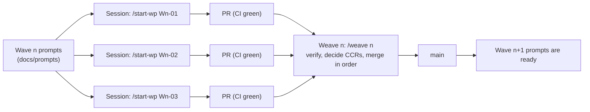

# Parallel development playbook

Status: accepted (2026-10-10). Audience: the owner (S0r81). This is the step-by-step guide for running BooksCraft's build with several Claude Code sessions at once: the one-time GitHub and cloud setup, launching a wave, the Weave that merges it, monitoring, recovery, and how many sessions to run. Claude Code facts were checked against the official documentation on 2026-10-10; the pages are listed in section 9.

Related: [CLAUDE.md](../../CLAUDE.md) (rules every session follows), [OWNERSHIP.md](../coordination/OWNERSHIP.md), [BOARD.md](../coordination/BOARD.md), [prompts index](../prompts/00-INDEX.md), [ROADMAP](../roadmap/ROADMAP.md), ADR-0027 and ADR-0028.

## 0. How the build runs



| Who | Does |
|---|---|
| You | Repository and environment settings, launching sessions, approving each merge, answering escalations, the hands-on checks on your Fedora machine, the sign-off identity |
| A work package session | Exactly one work package: reads its prompt, works only in its owned paths, opens a PR with evidence for every acceptance criterion |
| A Weave session (`lead-architect`) | Verifies the wave's PRs with independent reviewer subagents, decides CCRs, merges in order, updates the board and the docs |

Each work package (WP) has a prompt in `docs/prompts/` with the same twelve sections, a branch `wp/<WP>-<slug>`, and owned paths in OWNERSHIP.md. Sessions never touch each other's paths, so their PRs merge without conflicts. Anything shared goes through a contract change request (CCR) decided in the Weave.

## 1. One-time GitHub setup

### 1.1 First actions, in order

1. **Merge the architecture PR** (`architecture/foundation`). It has no CI yet. Use "Squash and merge" and add your `Signed-off-by:` line at the end of the commit message.
2. **Install the Claude GitHub App** on `S0r81/bookscraft`: open <https://github.com/apps/claude>, choose Configure, and grant it this repository. Projects and auto-fix need it.
3. **Set the repository options** in section 1.2.
4. **Fill in the sign-off identity** (section 1.4): edit `CLAUDE.md` §8 on `main` directly in the GitHub web editor, before branch protection exists.
5. **Create the cloud environment** `bookscraft` (section 2).
6. **Optional: create the Project** "BooksCraft build" (section 3.1).
7. **Launch W0-01** in one session: `/start-wp W0-01` (section 4.2). Wave 0 runs in order (section 4.3).
8. When W0-01's PR shows all ten checks, **turn on branch protection** (section 1.3), then run `/weave 0` to merge it.

### 1.2 Repository options

On GitHub, open the repository's **Settings**.

| Where | Setting |
|---|---|
| General → Pull Requests | Clear **Allow merge commits**. Check **Allow squash merging** and set its default commit message to **Pull request title and description**. Clear **Allow rebase merging**. |
| General → Pull Requests | Check **Always suggest updating pull request branches** and **Automatically delete head branches**. Leave **Allow auto-merge** off. |
| Code security | Enable **Private vulnerability reporting** (CONTRIBUTING.md points reporters there). |
| Actions → General | Keep Actions enabled. Default workflow permissions: **Read repository contents**. The release workflow (W5-01) asks for write access in its own file. |

### 1.3 Branch protection (after W0-01's checks have run once)

GitHub can only require a check whose name it has seen, so wait until W0-01's PR has run the ten jobs once. Then open **Settings → Branches → Add classic branch protection rule** for `main`:

- **Require a pull request before merging**, with 0 required approvals (you cannot approve your own PRs, and reviews happen in the Weave).
- **Require status checks to pass before merging** and **Require branches to be up to date before merging**, with these checks: `fmt`, `clippy`, `lint`, `test (ubuntu-latest)`, `test (windows-latest)`, `test (macos-latest)`, `deny`, `spine`, `scope`, `dco`.
- **Require linear history.**
- **Do not allow bypassing the above settings.**
- Leave **Allow force pushes** and **Allow deletions** off.

The same rule from a terminal with `gh` (save the JSON as `protection.json`):

```json
{
  "required_status_checks": {
    "strict": true,
    "contexts": ["fmt", "clippy", "lint", "test (ubuntu-latest)", "test (windows-latest)", "test (macos-latest)", "deny", "spine", "scope", "dco"]
  },
  "enforce_admins": true,
  "required_pull_request_reviews": { "required_approving_review_count": 0 },
  "restrictions": null,
  "required_linear_history": true,
  "allow_force_pushes": false,
  "allow_deletions": false
}
```

```sh
gh api -X PUT repos/S0r81/bookscraft/branches/main/protection --input protection.json
```

If GitHub itself breaks CI for a day (an outage), you can turn protection off and on again; never push to `main` directly while it is off.

### 1.4 Sign-off identity (open decision Q-9)

Every PR description ends with a DCO `Signed-off-by:` line, which becomes part of the squash commit (CONTRIBUTING.md). Sessions write that line on your behalf, so it must be yours: you certify the contribution when you approve its merge. Replace the placeholder in `CLAUDE.md` §8:

```text
Signed-off-by: SIGNOFF_NAME <SIGNOFF_EMAIL>
```

with your name and the address you want published in the git history (a GitHub `noreply` address works). Sessions stop and ask while the placeholder is there, and the CI `dco` job rejects it.

## 2. Cloud environment

Cloud sessions run in a fresh Ubuntu 24.04 VM (4 vCPU, 16 GB RAM, 30 GB disk) with Rust preinstalled. The environment adds BooksCraft's system packages and the pinned toolchain once, and the snapshot is reused by later sessions.

### 2.1 Create it

1. Open <https://claude.ai/code>. Select the cloud icon showing the current environment's name, in the row above the message box.
2. Select **Cloud**, then **Add cloud environment**.
3. Name: `bookscraft`. Network access: **Trusted** (the default list includes crates.io, static.rust-lang.org, rustup.rs, github.com and the Ubuntu archives).
4. Environment variables (section 2.3) and setup script (section 2.2). Save.
5. Pick `bookscraft` in the selector for every BooksCraft session, and in the Project's settings if you use one.

### 2.2 Setup script

It runs as root before Claude Code starts. It must exit 0, and it is cached only if it finishes in about five minutes, so it installs only what every session needs. Repository-specific steps run in the repository's SessionStart hook instead.

```bash
#!/bin/bash
# BooksCraft cloud environment setup: system packages for Tauri and WebDriver, plus the
# pinned Rust toolchain. Repository-independent. Always exits 0.
export DEBIAN_FRONTEND=noninteractive
(
  apt-get update -qq &&
  apt-get install -y -qq --no-install-recommends \
    build-essential pkg-config curl wget file \
    libwebkit2gtk-4.1-dev libssl-dev libxdo-dev libayatana-appindicator3-dev librsvg2-dev \
    webkit2gtk-driver xvfb
) > /tmp/bookscraft-apt.log 2>&1 &
apt_pid=$!

if ! command -v rustup >/dev/null 2>&1 && [ ! -x "$HOME/.cargo/bin/rustup" ]; then
  curl --proto '=https' --tlsv1.2 -sSf https://static.rust-lang.org/rustup/rustup-init.sh \
    | sh -s -- -y --profile minimal --default-toolchain none > /tmp/bookscraft-rustup.log 2>&1
fi
export PATH="$HOME/.cargo/bin:$PATH"
rustup toolchain install 1.98.1 --profile minimal --component rustfmt,clippy \
  --target wasm32-unknown-unknown >> /tmp/bookscraft-rustup.log 2>&1 \
  || echo "BooksCraft setup: toolchain install failed; see /tmp/bookscraft-rustup.log"

wait "$apt_pid" || echo "BooksCraft setup: apt install failed; see /tmp/bookscraft-apt.log"
exit 0
```

When a Weave changes the pinned toolchain in `rust-toolchain.toml`, update the version here too. Until you do, the SessionStart hook installs the new version at the start of each session, which only costs time.

Cargo tools are not installed here, to stay inside the five minutes. A session that needs them (Weaves need `cargo-deny`; W5-04 needs `tauri-driver`) runs `cargo xtask doctor --fix --tools`, which builds them from crates.io in a few minutes.

### 2.3 Environment variables

```text
BASH_DEFAULT_TIMEOUT_MS=600000
BASH_MAX_TIMEOUT_MS=1800000
```

Cold Rust builds take longer than the default two-minute command timeout.

### 2.4 What the repository adds at session start

`.claude/settings.json` runs `.claude/hooks/session-start.sh` on every start and resume, locally and in the cloud. It installs rustup if a cloud VM lacks it, installs the toolchain named in `rust-toolchain.toml`, runs `cargo xtask doctor --fix`, and warms the build cache in the background. Before W0-01 merges, it only reports that the toolchain file does not exist yet.

Other repository hooks: a guard that refuses edits outside the work package's owned paths on `wp/*` branches, `rustfmt` on every edited `.rs` file, and, at the end of every turn (the Stop event), a push check for unpushed commits followed by a fast `cargo check` of the changed crates; only the `cargo check` is skipped when nothing changed since the last passing check.

### 2.5 GitHub from a cloud session

- All GitHub traffic goes through a proxy that holds your credentials. It allows pushes of branches only (no tags, no deletions).
- GraphQL is blocked, so `gh pr ...` and `gh issue ...` fail. The skills use the REST API (`gh api repos/S0r81/bookscraft/...`) for everything.
- API requests work only for repositories attached to the session, and release downloads from other repositories are refused. That is why tools are built from crates.io and the UI build needs no Trunk.

## 3. Ways to run sessions

| Mode | Best for | Settings and hooks from the repo | Notes |
|---|---|---|---|
| Projects (section 3.1) | Running a whole wave from one conversation, watching from your phone | Yes, when the project has exactly one repository | Public beta on Pro and Max; threads run in auto mode, open PRs and watch CI with auto-fix |
| Separate cloud sessions (section 3.2) | Full control per session; plans without Projects | Yes | One session per WP, started in the browser or with `claude --cloud` |
| Local on Fedora (section 3.3) | The UI spike, desktop checks, anything needing your GPU or display | Yes | `claude --worktree <WP>` in tmux, one worktree per WP |

### 3.1 Projects

1. At claude.ai/code, select **Projects** in the left sidebar, then **New project**. Name it "BooksCraft build" and add only the `S0r81/bookscraft` repository as context. With a second repository, no repository's permission rules reach the threads.
2. Open the gear icon → **Environment** and choose `bookscraft`.
3. Open the gear icon → **Memory → Project instructions** and paste:

   ```text
   BooksCraft is built in work packages (WPs) with fixed owned paths, in the repository S0r81/bookscraft.

   - Every thread works on exactly one WP. Its first action is `/start-wp <WP id>`, or `/weave <wave>` for a Weave. The skill creates or resumes the branch wp/<WP>-<slug> from main. Use no other branch name.
   - Follow CLAUDE.md. Edit only the WP's owned paths. For anything else, raise a CCR with `/ccr`.
   - Never merge a pull request, force-push, rebase, or change CI, `.claude/` or docs outside the owned paths. Only a Weave thread merges, and only after I approve each merge in the thread.
   - To bring a branch up to date or resolve a conflict, merge origin/main into it. Never rebase, even if a button or an auto-fix message suggests it.
   - Before calling work done, run the prompt's Verify commands and `cargo xtask scope <WP>`, and paste the summary lines into the PR.
   - If something you need is missing (a contract, a dependency, a precondition, network access), say exactly what in your first message and stop that line of work. Do not substitute, mock or guess.
   - Commit and push after every meaningful step; a thread's sandbox can restart from a fresh clone.
   - If you must stop before the WP is done, run `/handoff`.
   ```

4. **Project settings → General**: new projects run threads on Opus at high effort, which uses your plan fastest. Keep that for ledger, storage, migration and Weave work; you may lower it for UI polish or packaging threads.
5. Approvals: threads run in auto mode, but the repository's `deny` rules still apply and its `ask` rules still prompt, inside the thread. Merges and deletions therefore wait for you in the Weave thread.

### 3.2 Separate cloud sessions

- **Browser:** at claude.ai/code, start a session on `S0r81/bookscraft`, branch `main`, environment `bookscraft`, and send `/start-wp W1-01` as the first message.
- **Terminal:** from an up-to-date clone on `main`, run `claude --cloud "/start-wp W1-01"`. The VM clones the GitHub remote at your current branch, not your local files.
- Open each session's CI status bar and turn on **Auto-fix** if you want it to react to CI failures. Tell it to merge `origin/main` rather than rebase.
- To continue a cloud session on your machine: `claude --teleport` (needs a clean working tree).

### 3.3 Local mode on Fedora

One-time:

```sh
sudo dnf group install "c-development"
sudo dnf install webkit2gtk4.1-devel openssl-devel curl wget file libappindicator-gtk3-devel librsvg2-devel libxdo-devel tmux
curl --proto '=https' --tlsv1.2 -sSf https://sh.rustup.rs | sh
git clone https://github.com/S0r81/bookscraft.git ~/src/bookscraft
cd ~/src/bookscraft && claude    # accept the workspace trust dialog once
```

Install Claude Code itself first if needed (see the quickstart in section 9). After W0-01 merges, run `cargo xtask doctor --fix --tools` once. For WebDriver tests you also need WebKitWebDriver: `dnf provides '*/WebKitWebDriver'` names the package.

Per wave, one tmux window with a pane per work package:

```sh
tmux new -s bookscraft
# in each pane:
cd ~/src/bookscraft && git pull --ff-only && claude --worktree W1-01
# then type in the session:
/start-wp W1-01
```

`--worktree W1-01` creates `.claude/worktrees/W1-01/` on its own branch; `/start-wp` then switches that worktree to `wp/W1-01-<slug>`. Each worktree builds into its own `target/` (several GB each), so watch your disk. When you exit, Claude Code offers to keep or remove the worktree; keep it until the PR is merged.

GPU note for desktop work (W0-06, W3-05): on NVIDIA with Wayland, WebKitGTK may draw a blank window. If it does before W3-05 lands, start the app with `WEBKIT_DISABLE_DMABUF_RENDERER=1`; from W3-05 on, `platform::webview::apply_env_fixups()` sets it.

## 4. Running a wave

### 4.1 Before launching

1. The previous Weave's PR is merged, and BOARD.md shows this wave's rows as `ready`.
2. The prompts you will launch exist in `docs/prompts/` and their preconditions name merged work only (each session checks again).
3. You know how many sessions you can afford (section 8). Launch in the batches listed in `docs/prompts/00-INDEX.md`.

### 4.2 Launch

| Mode | What to do |
|---|---|
| Projects | In the project conversation: "Start one thread per work package: W1-01, W1-02, W1-05. Each thread's first message is exactly `/start-wp <WP>`. Run at most 3 threads at a time. Do not merge anything." |
| Cloud sessions | One new session per WP with the first message `/start-wp <WP>`, or `claude --cloud "/start-wp <WP>"` per WP |
| Local | One tmux pane per WP: `claude --worktree <WP>`, then `/start-wp <WP>` |

A session that finds a failed precondition stops and says which one. A session that has to stop early writes a handoff note; start a new session with the same `/start-wp <WP>` and it continues from the note.

### 4.3 Wave 0 runs in order

| Order | WP | Starts when | Your part |
|---|---|---|---|
| 1 | W0-01 workspace, xtask, CI | the architecture PR is merged and sections 1–2 are done | Turn on branch protection once its PR shows the ten checks; run `/weave 0` to merge it |
| 2 | W0-02 contracts | W0-01 is merged | `/weave 0` merges it when green |
| — | W0-06 UI spike | W0-01 is merged; runs beside W0-02..W0-05 | Run the spike's checks on your Fedora machine (its prompt lists them) and record the results in the PR |
| 3 | W0-05 ledger core | W0-02 is merged | `/weave 0` merges it |
| 4 | W0-04 storage | W0-05 is merged | `/weave 0` merges it |
| 5 | W0-03 test harness and spine | W0-04 is merged | `/weave 0` merges it |
| 6 | Weave 0 close | W0-01..W0-06 are merged | `/weave 0` decides ADR-0002 with you, processes CCRs and opens Wave 1 |

In Wave 0, `/weave 0` is run after each PR turns green; it merges whatever is ready, in order, and closes the wave only when all six are merged.

### 4.4 Your hands-on checks

| WP | Check |
|---|---|
| W0-06 | The spike's eight criteria on your Fedora GNOME Wayland machine with the RTX 3060, including Orca and printing |
| W3-05 | The desktop app opens, renders, opens a URL through the portal, and stores a secret in GNOME Keyring |
| W4-03 | Your own Intuit developer app (client id and secret) and a sandbox company for recorded fixtures; confirm Intuit's current endpoint names, `minorversion` and report parameters (Intuit's pages may not load for agents) |
| W5-01 | The rpm installs and launches on Fedora |
| W5-04 | The pilot: migrate the agency's QBO sandbox company, then production, and close one month (`docs/process/PILOT_RUNBOOK.md`) |

## 5. The Weave

### 5.1 When

Start the Weave when every PR of the wave is green, or when you decide to defer the stragglers. Run it in a fresh cloud session or project thread with the first message `/weave <n>`. Wave 0 is the exception (section 4.3).

### 5.2 What it does

1. Checks branch protection and collects the wave's PRs, their checks and the CCR files they add.
2. Spawns a fresh `qa-verifier` subagent per PR, given only the PR and its prompt, and a `security-reviewer` for the sensitive work packages. Failures go back to the work package; the Weave never patches a WP branch itself.
3. Decides each CCR (accept, reject, supersede). A blocking CCR is implemented first in its own Weave PR, so the waiting work package can merge `origin/main` and finish.
4. Merges, one PR at a time: update the branch (GitHub's update-branch, a merge commit), wait for green, squash-merge with the PR title and description. You approve each merge.
5. Closes the wave on its own branch: full `cargo xtask ci`, BOARD.md, CCR decisions, ADRs, specs, later prompts, generated docs, then the Weave PR, merged the same way.
6. Reports what merged, the CCR decisions, the spine counts against the plan, and what to launch next.

### 5.3 Merge order

1. The Weave's contract PR (accepted blocking CCRs), if there is one, titled `Weave <n> (interim): …`.
2. The wave's work packages in the order listed in its Weave prompt: libraries before the services that use them, services before routes, routes before UI.
3. The Weave PR that closes the wave, titled `Weave <n>: …`. Later prompts check for exactly that title, so no other PR may use it.

Each merge makes the next PR out of date, so each one runs CI again before it merges. That is the price of a `main` that is always green.

### 5.4 Approving a merge

Approve when the Weave shows: all required checks green on the updated branch; the qa-verifier's verdict `pass` (and the security reviewer's, where required); `cargo xtask scope` output with no foreign paths; the PR description's acceptance criteria with output; and a `Signed-off-by:` line. Say no, and tell the Weave why, if any of these is missing.

### 5.5 Timing

Expect each merge to take one CI run (estimate: 10–30 minutes on three OSes once the build cache is warm, more when it is cold), so a five-PR wave takes a few hours of mostly waiting. The Weave polls the checks; you only need to come back for the approvals.

## 6. Monitoring

| Where | What you see |
|---|---|
| `/status` in any session | Board state, every open PR with its checks, open CCRs, what can launch next and what is blocked |
| Projects → **Overview** | Threads that finished, are working, or wait for you (the dot on **Overview**) |
| GitHub → Pull requests | Checks per PR; the `scope` and `dco` jobs explain their own failures |
| `docs/coordination/BOARD.md` on `main` | The plan's state, updated by Weaves |

| Signal | Meaning | Do |
|---|---|---|
| A session or thread is idle with a question | It needs a decision or an approval | Answer in that session or thread; a message in the project conversation does not reach a waiting thread |
| `scope` fails on a PR | The PR touched a path it does not own | Tell the session to move that change into a CCR and remove it from the branch with a new commit |
| `spine` fails | A capability was registered before its feature was complete, or two merged features disagree | Do not merge more PRs; ask the Weave to find the step and the responsible PR |
| A CCR is marked blocking | A work package cannot finish without a contract change | Run the Weave early for that CCR, or defer the WP |
| The same failure after two fixes | The session hit a stop condition | Read its report; decide whether to re-scope, defer, or change the spec in a Weave |

## 7. Recovery

Never force-push, rebase shared branches, amend pushed commits or delete history. Every fix is a new commit.

| Situation | What to do |
|---|---|
| A session ran out of context, crashed, or its sandbox restarted | Start a new session with `/start-wp <WP>`. It resumes the branch, the PR and the handoff note. Unpushed work is lost, which is why sessions push after every commit. |
| A PR is behind `main` or has a conflict | The session runs `git merge origin/main`, resolves inside its owned paths, commits and pushes. A conflict outside its paths means a scope problem: CCR. |
| `main` is red after a merge | The Weave opens a revert PR (`git revert <merge commit>` on a new branch `weave/W<n>-revert`, which the push rules and the `scope` check accept), merges it, and sends the work package back to fix. |
| Wrong content merged | Same: a revert PR, never a force-push. |
| The guard hook refuses an edit the work package needs | Either the work belongs to another WP (CCR), or OWNERSHIP.md is wrong (CCR to the Weave, which fixes the row). |
| A work package must be abandoned | Close its PR with a reason, mark it `blocked` or deferred on the board in the next Weave, and delete the branch on GitHub (the proxy cannot delete branches). |
| Toolchain or setup problems | Read the SessionStart output and `cargo xtask doctor`; fix the environment's setup script or variables; start a new session. |
| A session keeps asking for approvals you consider routine | Change `.claude/settings.json` in a Weave (it is a Weave-only path), never in a work package. |
| A local worktree is stuck or locked | `git worktree list`, then `git worktree unlock <path>` and `git worktree remove <path>` once its branch is pushed. |

## 8. How many sessions at once

| Constraint | Guidance |
|---|---|
| Your plan | Every session and thread uses your plan's limits, and a project uses them faster. Start with 3 concurrent work packages (decision Q-3). On Pro, 1–2 is more realistic; on Max, 3–5. A thread that hits the limit waits and resumes when the limit resets. |
| Waves | Each wave has 4–5 work packages; `docs/prompts/00-INDEX.md` splits them into batches of up to 3, critical path first. |
| Cloud VMs | 4 vCPU and 16 GB each. Sessions build single crates (`-p <crate>`); full-workspace builds compile Tauri and Typst and take much longer. |
| Your Fedora machine | Each local session compiles in its own worktree. Two local sessions plus cloud sessions for the rest is a comfortable mix. |
| Projects limit | 200 new threads per day across your projects; not a constraint at this scale. |
| Never | Two sessions on the same work package, or a work package whose preconditions are not merged. |

## 9. Claude Code and GitHub pages this playbook relies on

| Page | Used for |
|---|---|
| [Use Claude Code in the cloud](https://code.claude.com/docs/en/claude-code-on-the-web) | Starting cloud sessions, `--cloud`, `--teleport`, auto-fix, GitHub App |
| [Configure cloud environments](https://code.claude.com/docs/en/cloud-environments) | Environment dialog, setup script rules and caching, Trusted allowlist, GitHub proxy (branch-only pushes, GraphQL blocked), VM resources, command timeouts |
| [Projects](https://code.claude.com/docs/en/claude-projects) | Project creation, instructions, thread behavior, auto mode, approvals, limits |
| [Run parallel sessions with worktrees](https://code.claude.com/docs/en/worktrees) | `--worktree`, `worktree.baseRef`, subagent worktrees, cleanup |
| [Hooks reference](https://code.claude.com/docs/en/hooks) | SessionStart, PreToolUse, PostToolUse, Stop; exit code 2; `CLAUDE_ENV_FILE`, `CLAUDE_PROJECT_DIR`, `CLAUDE_CODE_REMOTE`; async hooks |
| [Configure permissions](https://code.claude.com/docs/en/permissions) | Rule syntax and precedence (deny, ask, allow), compound commands, workspace trust |
| [Settings](https://code.claude.com/docs/en/settings) | Where `.claude/settings.json` applies, including cloud sessions |
| [Create custom subagents](https://code.claude.com/docs/en/sub-agents) | Agent frontmatter (`tools`, `model`, `isolation: worktree`) |
| [Extend Claude with skills](https://code.claude.com/docs/en/skills) | Skill layout, frontmatter, `$ARGUMENTS` and `$0` |
| [How Claude remembers your project](https://code.claude.com/docs/en/memory) | `CLAUDE.md` size guidance |
| [Run agents in parallel](https://code.claude.com/docs/en/agents) | Choosing between subagents, worktrees and projects |
| [Quickstart](https://code.claude.com/docs/en/quickstart) | Installing Claude Code locally |
| [About protected branches](https://docs.github.com/en/repositories/configuring-branches-and-merges-in-your-repository/managing-protected-branches/about-protected-branches) | Protection on a public repository |
| [Configuring pull request merges](https://docs.github.com/en/repositories/configuring-branches-and-merges-in-your-repository/configuring-pull-request-merges) | Squash-only merging, default commit message, auto-deleting branches |

## 10. How this process was checked

The traceability matrix (every MVP feature to tables, posting rules, API and prompts) and the invariant coverage (every invariant to a test and the prompt that writes it) are in [ROADMAP §7–§8](../roadmap/ROADMAP.md). Three rounds of independent review (fresh qa-verifier subagents, five reviews in all) checked the docs and prompts for contradictions, overlapping owned paths, unfailable acceptance criteria, missing conflict rules and ledger arithmetic. [BRIEF_AUDIT §11](../architecture/BRIEF_AUDIT.md) logs every round and how its findings were fixed; none was rejected.
