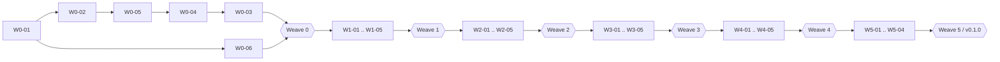

# Roadmap

Status: accepted (2026-10-10). Owner: `lead-architect`; the owner (S0r81) approves scope changes. This roadmap maps the brief's phases ([brief](../research/bookscraft-brief.md) §3 and §9) onto BooksCraft's waves and milestones, as changed by the owner's decisions ([BRIEF_AUDIT](../architecture/BRIEF_AUDIT.md)). It ends with the Step 2 self-check: every MVP feature traced to tables, posting rules, API and prompts (section 7), and every invariant traced to a planned test (section 8).

## 1. Phases

| Phase (brief §9) | BooksCraft milestone | Contents | Exit |
|---|---|---|---|
| Phase 0: Foundations | Architecture PR + **Wave 0** | Repository, licenses, DCO, process; workspace, toolchain, xtask, 3-OS CI; contracts; ledger core with property and golden tests; storage with every trigger tested; test harness and scenario spine; UI spike | Weave 0 merged: all of Wave 0 on `main`, spine reports 31 pending and 0 failed, ADR-0002 decided |
| Phase 1: MVP "Freelancer and agency books" | **Waves 1–5**, release `v0.1.0` | Section 3 | The MVP exit (section 2) |
| (owner decision D-2) | **M-WM: Windows and macOS** | Signed Windows installer, signed and notarized macOS dmg, auto-update, platform QA (section 5) | Section 5 |
| Phase 2: v1 "QBO Plus parity without tiers" | **v1** | Section 6.1 | Every v1 item shipped behind its own prompts and Weaves |
| Phase 3: Later | **Later** | Section 6.2 | — |

Ledger core, property tests and golden tests land in Wave 0 and Wave 1, before any UI work package (UI starts in Wave 2). File import (Wave 2) and the QBO migrator (Waves 3–4) land before the reports are considered done: the MVP exit validates reports against QuickBooks's own reports.

## 2. MVP exit criterion

> A real agency migrates from QuickBooks Online and closes a month with a trial balance that matches QuickBooks to the cent.

How it is verified:

1. The pilot company is the owner's agency (decision Q-8). The owner installs the release candidate (`v0.1.0-rc.N`, cut in Weave 5 part A) and follows `docs/process/PILOT_RUNBOOK.md` (written in W5-04): migrate the QBO sandbox company first, then production, into a new company file.
2. Migration validation passes with no unexplained difference: month-end trial balance for every imported month and AR/AP aging per contact equal QuickBooks's reports to the cent; any residual journal entry is listed and acknowledged (MIGRATION_SPEC §6).
3. The owner records one real month in BooksCraft (bank import and review, reconciliation, invoices, bills), soft-locks it, and compares BooksCraft's trial balance as of month-end with QuickBooks's trial balance for the same date: every account equal to the cent.
4. `docs/process/RELEASE_CHECKLIST.md` (W5-04) is complete: every wave merged, spine green, end-to-end suite green, security reviews done, Linux packages built and installed, pilot evidence attached as a summary without real data. Weave 5 part B then prepares `v0.1.0`, which the owner tags.

Cash-basis parity with QuickBooks is measured and reported, not part of the exit (R-3).

## 3. MVP wave plan

| Wave | Work packages | Theme |
|---|---|---|
| 0 | W0-01 workspace, xtask, CI · W0-02 contracts · W0-05 ledger core and posting framework · W0-04 storage · W0-03 test harness and spine · W0-06 UI spike | Foundations, in that order (W0-06 alongside) |
| 1 | W1-01 posting rules · W1-02 books service · W1-03 identity · W1-04 interchange, OFX and IIF libraries · W1-05 API framework, composition root, company, identity and books routes | Core services and the API |
| 2 | W2-01 sales · W2-02 purchases · W2-03 banking · W2-04 reports · W2-05 UI foundation | Daily bookkeeping end to end (the spine passes) |
| 3 | W3-01 UI sales · W3-02 UI purchases and banking · W3-03 QBO mapper · W3-04 migration pipeline · W3-05 platform and desktop shell | Screens, migration, desktop |
| 4 | W4-01 UI reports, close, audit, migration wizard · W4-02 server and CLI · W4-03 QBO connector · W4-04 PDF, preview, email · W4-05 SimpleFIN feeds | Completing the MVP surface |
| 5 | W5-01 Linux packaging and release · W5-02 MCP server (stretch) · W5-03 print, email, polish, accessibility · W5-04 end-to-end suite, pilot runbook, release checklist | Shipping |

Each wave ends with a Weave (W0-W … W5-W). Batches, merge order and concurrency are in [docs/prompts/00-INDEX.md](../prompts/00-INDEX.md).

## 4. Scenario spine plan

The spine (ADR-0029, LEDGER_SPEC Appendix A) has 31 steps that run in order. Each Weave's acceptance checks these counts.

| After | Passed | Failed | Pending | Why |
|---|---|---|---|---|
| Weave 0 | 0 | 0 | 31 | No service registers a capability yet |
| Weave 1 | 2 | 0 | 29 | `books` registers its capabilities: S01 (company, accounts, contacts, tax, dimensions) and S02 (opening balance) run; S03 needs `Invoices` |
| Weave 2 | 31 | 0 | 0 | Sales, purchases, banking and reports complete the story, including the golden reports |
| Weaves 3–5 | 31 | 0 | 0 | No regressions; W3-04 adds the interchange round trip of the spine company (T-MIG-3) |

## 5. Milestone M-WM: Windows and macOS

Starts after `v0.1.0` and can run beside v1. Both OSes are built and tested in CI from W0-01, so this milestone is about installers, signing, updates and hands-on QA.

| Item | Default approach | Owner role | Needs from the owner |
|---|---|---|---|
| WM-01 Windows installer | `cargo xtask package msi` (Tauri bundler, WiX), Authenticode signing in the release workflow | platform-release-engineer | A code-signing certificate and its secret in the repository |
| WM-02 macOS dmg | `cargo xtask package dmg`, Developer ID signing and notarization in the release workflow | platform-release-engineer | An Apple Developer Program membership and its credentials as secrets |
| WM-03 Auto-update | Tauri updater with signed update manifests for AppImage, Windows and macOS; distro packages keep updating through their repositories | platform-release-engineer | An updater signing key kept as a secret |
| WM-04 Platform QA | Manual checklist on Windows 11 and macOS: custom protocol (`http://bookscraft.localhost` on Windows), Credential Manager and Keychain, URL opening, file dialogs, printing from WKWebView, high-DPI; desktop end-to-end on Windows through `tauri-driver` (no macOS WebDriver exists) | qa-verifier | A Windows 11 and a macOS machine or VM for the manual pass |

Exit: signed installers for both OSes attached to a release; updating from one release to the next works on Linux (AppImage), Windows and macOS; the WM-04 checklist passes. Prompts for WM-01..WM-04 are written by the lead-architect in Weave 5, part A (W5-W), as wave 6 in OWNERSHIP and BOARD.

## 6. After the MVP

Every item has a default approach and an owner role. Prompts are written in the planning Weave that opens each batch.

### 6.1 v1

| Item | Default approach | Owner role |
|---|---|---|
| Dimension management UI (Class, Location, Project and custom tags) | Settings pages over the existing dimension tables and API | ui-engineer |
| Projects and job costing | Project dimension plus a profitability report from the report engine | ledger-engineer |
| Billable time and expenses | Time entries table (migration in a Weave), billable lines pulled into invoices | ledger-engineer |
| Budgets and budget vs actual | Budget table per account, dimension and period; report engine comparison | ledger-engineer |
| Cash-flow statement (indirect) | Derived from balance sheet changes with an account mapping | ledger-engineer |
| Report builder and dashboards | Saved report definitions over the existing engine (group, filter, compare) | ledger-engineer, ui-engineer |
| Recurring transactions | Templates plus scheduled jobs creating drafts or posted documents | ledger-engineer |
| Custom fields management UI | Settings pages over the existing tables; values on forms | ui-engineer |
| Batch entry | Grid entry and CSV bulk create through the same commands | ui-engineer, import-migration-engineer |
| Teller and Plaid feeds (server mode) | `BankProvider` implementations; enrollment in the system browser (ADR-0018) | bank-feeds-engineer |
| Payment links (Stripe, PayPal) | Record payments and fees from processor webhooks; BooksCraft never moves money (I-11) | api-engineer |
| Sales tax filing and payment records | Records against agency liability accounts; reports by period | ledger-engineer |
| 1099 tracking and PDF forms | Vendor flag and account-to-box mapping as data; thresholds as versioned data (CV-8) | ledger-engineer |
| Multi-currency | FX rates, realized and unrealized gain or loss (LEDGER_SPEC §8.2); reversible enabling | ledger-engineer |
| IIF import path and writer; QuickBooks Desktop report-based migration | Uses the MVP `iif` library; validation by monthly trial balance | import-migration-engineer |
| Accountant workspace | Multi-client switcher, review tools, closing checklist, record-level scopes | api-engineer, ui-engineer |
| OIDC sign-in and custom roles | `identity` extension; permission matrix stays in `domain` | api-engineer |
| AI-suggested categorization | Rules plus a model of the user's choice through MCP, drafts only (I-10) | api-engineer |
| Hosted QBO OAuth relay | Only after the owner or a lawyer reviews Intuit's developer terms (ADR-0017) | import-migration-engineer |
| Installable PWA, receipt capture, OCR to draft expense | Same UI bundle; bring-your-own OCR or model | ui-engineer |
| Desktop "connect to server" and a local socket for CLI and MCP while the desktop runs | ADR-0004 follow-up | platform-release-engineer |
| Encryption at rest | Evaluate SQLCipher; changes the file format, so it needs an owner decision first (G-14) | storage-engineer |

### 6.2 Later

FIFO inventory, purchase orders and COGS; e-commerce importers (Shopify, Stripe payouts); automated address-based sales tax providers behind `TaxRateProvider`; 1099 e-file through a partner; approval workflows; multi-entity and consolidation; payroll integrations (journal sync only, I-11); native mobile apps; locale packs (UK and EU VAT, Canada GST/HST) through `LocalePack`; Beancount and ledger-text export; Enable Banking for the EU. Default owner role for planning: lead-architect.

## 7. Traceability: MVP features

Every MVP feature (brief §3 rows marked MVP, §9 Phase 1, and the scope moves the owner accepted: manual sales tax, server mode with local accounts, attachments, Linux desktop) maps to tables, posting rules, API surface and at least one prompt.

| # | MVP feature | Tables (schema.sql) | Posting (LEDGER_SPEC) | API (API.md) | Prompts |
|---|---|---|---|---|---|
| 1 | Double-entry ledger, immutable postings, reversals | `journal_entry`, `posting`, `posting_dimension`, `lock_override` | §3, §6 | `documents/{id}/journal`, `post`, `void` | W0-04, W0-05, W1-01 |
| 2 | Chart of accounts with templates, sub-accounts, unlimited | `account` | §2 | `/accounts`, `/account-templates` | W1-02, W2-05 |
| 3 | Manual journal entries, attachments, reversing entries | `document`, `document_line`, `attachment_link` | §4.16 | `/journal-entries` | W0-05, W1-02, W2-05 |
| 4 | Customers, vendors, items, terms, payment methods | `contact`, `item`, `bundle_component`, `term`, `payment_method` | — | `/contacts`, `/items`, `/terms`, `/payment-methods` | W1-02, W2-05 |
| 5 | Invoices, sales receipts, payments received, credit memos, with the application graph | `document`, `document_line`, `document_tax_line`, `settlement` | §4.1–§4.4, §5 | `/invoices`, `/sales-receipts`, `/customer-payments`, `/credit-memos` | W1-01, W2-01, W3-01 |
| 6 | Estimates converted to invoices | `document`, `document_link` | §4.7 | `/estimates`, `/estimates/{id}/convert` | W1-01, W2-01, W3-01 |
| 7 | Refund receipts and customer refunds | `document`, `settlement` | §4.5, §4.6 | `/refund-receipts`, `/customer-refunds` | W1-01, W2-01, W3-01 |
| 8 | Bills, bill payments, vendor credits | `document`, `settlement` | §4.8–§4.10 | `/bills`, `/bill-payments`, `/vendor-credits` | W1-01, W2-02, W3-02 |
| 9 | Expenses and checks, card credits, vendor refunds | `document`, `settlement` | §4.11–§4.13 | `/expenses`, `/card-credits`, `/vendor-refunds` | W1-01, W2-02, W3-02 |
| 10 | Bank file import (OFX, QFX, QBO, CSV) with dedupe | `bank_import`, `bank_txn` | §11 (dedupe) | `/bank-imports` | W1-04, W2-03, W3-02 |
| 11 | Bank review (match, add, transfer, exclude) and rules | `bank_txn`, `bank_txn_action`, `bank_rule`, `clearing_event` | §11 | `/bank-transactions/*`, `/bank-rules` | W2-03, W3-02 |
| 12 | Reconciliation with immutable reports | `reconciliation`, `reconciliation_line`, `clearing_event` | §11 | `/reconciliations/*`, `/clearing/unreconcile` | W2-03, W3-02 |
| 13 | Undeposited funds, deposits, transfers | `document`, `document_line` (`deposit_source`) | §4.14, §4.15 | `/deposits`, `/transfers` | W1-01, W2-03, W3-02 |
| 14 | Core reports, accrual and cash | views `ledger_line`, `active_settlement` | §7, §12 | `/reports/*` | W2-04, W4-01 |
| 15 | Period close and lock dates | `company` (lock dates), `lock_override` | §9 | `/period-locks` | W1-02, W4-01 |
| 16 | Hash-chained audit log and viewer | `audit_event` (company and system files) | §10 | `/audit-events`, `documents/{id}/history` | W0-04, W2-04, W4-01 |
| 17 | Multi-user with basic roles (server mode) | system `user`, `membership`, `session`, `api_token` | — | `/session`, `/users`, `/members`, `/tokens` | W1-03, W1-05, W2-05, W4-02 |
| 18 | QBO migrator (API) and CSV import, validated by trial balance and agings | `external_ref`, `import_run`, `import_archive` | §8.1 | `/imports/*`, `/imports/qbo/*` | W3-03, W3-04, W4-03, W4-01 |
| 19 | Export bundle ("you can leave") | all tables (read) | — | `/exports` | W1-04, W3-04 |
| 20 | Manual sales tax and liability by agency | `tax_agency`, `tax_rate`, `tax_code`, `tax_code_rate`, `document_tax_line` | §4.1, §4.18 | `/tax-agencies`, `/tax-rates`, `/tax-codes`, `/reports/sales-tax-liability` | W0-02 (`money::calc`), W1-02, W2-01, W2-04 |
| 21 | Invoice PDF and email | `number_sequence`, system `job` | — | `documents/{id}/pdf`, `/preview`, `/send`, `/settings/email` | W4-04, W5-03 |
| 22 | Attachments (receipt upload) | `attachment`, `attachment_blob`, `attachment_link` | — | `/attachments` | W1-02, W2-05 |
| 23 | Generic dimensions: schema, posting, import, report filters | `dimension`, `dimension_value`, `document_dimension`, `document_line_dimension`, `posting_dimension` | §3 rule 7 | `/dimensions`, report `dim[...]` filters | W0-05, W1-01, W1-02, W2-04 |
| 24 | Custom field values (unlimited) | `custom_field_def`, `custom_field_value` | — | `/custom-fields` | W1-02 |
| 25 | SimpleFIN live feeds (late MVP) | `bank_feed`, system `secret` | §11 | `/bank-feeds/*` | W4-05, W3-02 |
| 26 | Opening balances and cut-over | `document` (`opening_balance`) | §4.17 | `/opening-balances` | W0-05, W1-02, W3-04 |
| 27 | Agent drafts and audited human approval (MCP as stretch) | `document` (`created_by_actor_type`, `approved_by_user_id`) | §6 (Approve) | `/approvals`, `documents/{id}/approve`, MCP tools (§8) | W1-02, W1-05, W5-02 |
| 28 | Backup and verify | `audit_event`, `journal_entry` (content hash) | §10 | `/backups`, `/verify`, `bookscraft verify` | W0-04, W1-02, W4-02 |
| 29 | Linux desktop app | — | — | custom protocol (ARCHITECTURE §5) | W0-06, W3-05, W5-01 |
| 30 | Server mode and CLI | system file | — | API.md §9 | W1-05, W4-02 |
| 31 | Keyboard-first, accessible UI | — | — | all of the above through `/api/v1` | W0-06, W2-05, W3-01, W3-02, W4-01, W5-03 |

Result of the check: no MVP feature lacks a table, a rule where it posts, an API surface, or a prompt.

## 8. Invariant coverage

Every locked invariant has at least one planned test, written by a named work package. Test ids come from LEDGER_SPEC §13, DATA_MODEL §6, MIGRATION_SPEC §12 and API.md §6.

| Invariant | Tests | Written by |
|---|---|---|
| I-1 Money exact | T-MONEY-1, T-MONEY-3, T-MONEY-4 (proptests); T-MONEY-2 (`disallowed-types` plus lint); T-MIG-4 (import rounding) | W0-02; W0-01; W3-04 |
| I-2 Pure, versioned posting | T-POST-1 (determinism); T-POST-2 (pure-crate lint); T-POST-3 (golden per type and version) | W0-05, W1-01; W0-01; W1-01 |
| I-3 Append-only, balanced | T-LEDGER-1, T-LEDGER-2; T-STORE-1..4, T-STORE-6..10, T-STORE-20; T-PROP-1; T-SALES-1 | W0-05; W0-04; W0-03 (active from Wave 2); W2-01 |
| I-4 Cash basis derived | T-REP-1; T-SPINE-CASH | W2-04; W0-03 |
| I-5 Period locks | T-STORE-12; T-BOOKS-1; spine S30 | W0-04; W1-02; W0-03 |
| I-6 Audit chain | T-STORE-13 (triggers), T-STORE-19 (verify); T-AUDIT-1 | W0-04; W0-03 (used by every service work package) |
| I-7 External ids, idempotent imports | T-MIG-1; T-BANK-1; T-STORE-15 | W3-04 and W4-03; W2-03; W0-04 |
| I-8 Generic dimensions | T-BOOKS-2; T-POST-4 | W1-02; W1-01 |
| I-9 No tier gating | T-LIMIT-1 (books and identity parts, plus the count-limit lint) | W1-02, W1-03, W0-01 |
| I-10 Agents draft only | T-API-1, T-API-2; T-ID-1, T-ID-2; T-BOOKS-3; T-MCP-1; spine S28 | W1-05; W0-02, W1-03; W1-02; W5-02; W0-03 |
| I-11 No payroll, money movement or tax filing | T-SCOPE-1 (OpenAPI path denylist and cargo-deny bans) | W1-05, W0-01 |
| I-12 Licensing | T-LIC-1 (`cargo deny`), T-LIC-2 (MIT closure lint), T-LIC-3 (SPDX lint) | W0-01 |
| I-13 Cross-platform | T-PLAT-1 (3-OS CI), T-PLAT-2, T-PLAT-3 (cfg and process lints), T-PLAT-4 (line endings), T-PLAT-5 (case-insensitive names) | W0-01; W0-04 |

Result of the check: every invariant has at least one planned test and an owning work package. The qa-verifier checks in each Weave that the tests exist and would fail if the invariant broke.

## 9. Scope changes from the brief

| Change | Decision | Reference |
|---|---|---|
| All code in Rust; UI in Leptos (WASM) inside Tauri | Owner decision D-1; UI provisional until W0-06 | BRIEF_AUDIT OV-1, ADR-0002, ADR-0030 |
| SQLite only, one file per company | Owner decision D-2 consequence | ADR-0003 |
| Desktop is an MVP deliverable (Linux first); Windows and macOS installers in M-WM | Owner decision D-2 | ADR-0026 |
| Manual sales tax moves into the MVP | Owner default Q-7 (brief contradiction C-1) | ADR-0016 |
| Server mode with local accounts in the MVP; OIDC and the accountant workspace in v1 | Owner default Q-7 (C-10) | ADR-0023 |
| PWA, receipt capture and OCR move to v1; attachments stay in the MVP | Owner default Q-7 (C-2) | this roadmap |
| Dimensions: schema, posting, import and report filters in the MVP; management UI in v1 | C-5 | ADR-0014 |
| IIF: library in the MVP; import path in v1 | Brief §3 | MIGRATION_SPEC §1 |
| MCP server: late-MVP stretch (the agent rule ships in the MVP regardless) | Brief puts MCP in v1; I-10 enforcement must exist in the MVP | ADR-0022 |
